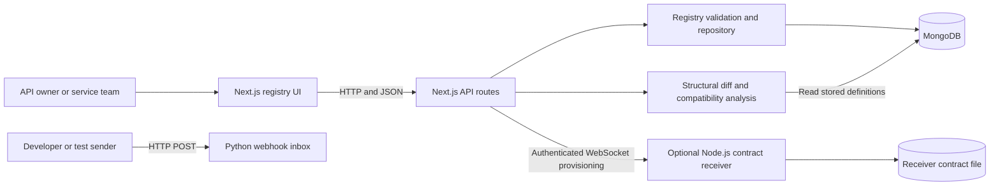

# Contract Guard design

Contract Guard gives API owners and service teams a shared view of published contracts, declared consumer dependencies, and the impact of contract changes. It accepts OpenAPI and consumer YAML, keeps uploaded revisions in MongoDB, and derives diffs and structural compatibility from those records.

See [README.md](README.md) for setup and API routes, [Progress.md](Progress.md) for implementation history and verification, and [Plan.md](Plan.md) for the runtime health proposal.

## Architecture

| Layer | Responsibility |
| --- | --- |
| [Pages and components](src/components) | Registry overview, create forms, entity details, upload dialogs, definition tree, version diff, and dependency graph. |
| [API routes](src/app/api) | Handle HTTP requests, validate route IDs, and expose registry, diff, graph, analysis, and provisioning operations. |
| [Registry](src/lib/registry) | Validate request and YAML structure, enforce upload rules, and read or write MongoDB records. |
| [Diff](src/lib/diff) and [analysis](src/lib/analysis) | Compute two views of stored contracts. The diff describes changes between API revisions. Compatibility evaluates one consumer declaration against one provider revision. |
| [Starter kit](contract-guard-starter-kit) | Runs the notification inbox and, with the optional Compose profile, the simulated contract receiver. |

## Data model

| Record | Identity and contents |
| --- | --- |
| API or service | MongoDB ObjectId, unique case-sensitive name within its collection, owner, and timestamps. |
| API version | API ObjectId, unique version label within that API, parsed OpenAPI definition, source filename, SHA-256 of the original upload, and creation time. |
| Service definition | Service ObjectId, parsed consumer definition, source filename, source hash, creation time, and a `bindings` array. Identical file bytes are rejected within the same service. |
| Consumer use | One provider name, HTTP method and path, and lists of fields the service sends and reads. A stored binding can identify one use by its zero-based index and point to an exact API version ObjectId. Current uploads initialize bindings as empty. |
| Provisioned contract | Receiver-owned record keyed by API and version ObjectIds. The receiver persists endpoint definitions to its own file. The registry returns the provisioning outcome in the request response. |

MongoDB is the source of truth for uploaded definitions. Diffs and compatibility results are derived on demand. The overview graph uses the latest service definition by creation time and record ID. Historical service definitions have their own analysis endpoint. [Registry schemas](src/lib/registry/schema.ts) · [Graph assembly](src/lib/analysis/graph.ts)

## Main workflows

### Upload and provision

1. The browser uploads a multipart YAML file. The server validates the request, parses the file into a JSON-compatible document, and checks the core contract fields.
2. The registry saves the revision with its source hash and filename. The API version comes from `info.version` or an explicitly supplied version when the field is absent.
3. For an API version, the server sends a YAML serialization of the stored definition to the optional contract receiver. The saved version remains available when provisioning fails or the receiver is unconfigured.
4. The receiver creates mock routes for supported inline operations and stores their definitions. Equivalent provisioning requests are idempotent. The provision endpoint can retry a specific saved version by its record ID. [Upload controller](src/lib/registry/controller.ts) · [Receiver integration](src/lib/receiver/provision.ts) · [Receiver server](contract-guard-starter-kit/contract-receiver/server.mjs)

### Compare and assess

- **API revision comparison.** The version timeline orders revisions by upload time. Selecting a link compares adjacent revisions. The diff API also accepts any two distinct revision IDs belonging to the same API. It returns categorized additions, removals, and changes, with values and a truncation flag where applicable. [Diff engine](src/lib/diff/compare.ts)
- **Consumer compatibility.** The analyzer matches provider names and checks exact methods and paths, required parameters, request and response fields, and supported local references. Results are structural match, incompatible, or warning. A warning means the analyzer could not verify some part of the declaration. The graph can show multiple matching revisions because it represents declared usage. [Compatibility analyzer](src/lib/analysis/analyze.ts)
- **Notification inbox.** The original webhook accepts test messages over HTTP and displays them in an auto-refreshing dashboard. Its message history lives in memory. Notification sending from the registry is an open feature. [Webhook receiver](contract-guard-starter-kit/webhook-receiver/app.py)

## Interface

| Screen | Design and interaction |
| --- | --- |
| Registry overview | List APIs and services, start a create flow, and inspect the dependency map. React Flow provides drag, pan, zoom, and selection. Green edges indicate structural matches and dashed edges indicate a dependency without a confirmed match. A side panel lists the verdicts and reasons for each version. |
| API detail | Inspect uploaded versions and the expandable definition tree. The timeline opens a filterable diff panel. Upload feedback includes the contract receiver outcome when available. |
| Service detail | Inspect service revision history, the full parsed definition, and declared uses grouped by provider and endpoint. Each endpoint shows the fields it sends and reads. |
| Create and upload forms | Show input requirements near the relevant field, report validation errors, and expose loading and submission states. |

The UI uses a light canvas, white panels, purple primary actions, Arial and Helvetica text, and Lucide icons. Shared styles define the page shell, responsive layouts, and visible keyboard focus. The graph provides a list of connections alongside the canvas, and its result panel includes text labels as well as color. [Shared styles](src/app/globals.css) · [Registry graph](src/components/registry-graph.tsx)

## Deployment and boundaries

The registry runs as a Next.js Node.js process with a server-side MongoDB connection. Initialize the MongoDB validators and indexes before using the registry. The registry routes currently rely on a trusted environment. The contract receiver requires a bearer token for provisioning and mock requests. Plain WebSocket provisioning is restricted to loopback addresses by the registry client. Docker binds the optional contract receiver to localhost and stores its state in a named volume. [Database connection](src/lib/mongodb.ts) · [Compose services](contract-guard-starter-kit/docker-compose.yml)

Compatibility covers declared contract structure within the analyzer's supported OpenAPI features. The mock endpoints acknowledge matching calls. Deployed versions, real response behavior, and real API availability require separate evidence.

## Planned runtime health

Persist provisioning and check results by API version ID. Backfill existing versions and run an initial check after provisioning. Add manual checks and a three-minute schedule, with timeouts and coordination to prevent overlapping checks for the same version. The graph can then read stored health summaries and show them alongside structural compatibility.

The probe interface and scheduling environment are still open decisions. The health labels are intended to describe the simulated endpoints. Actual deployment tracking and editable service-to-version bindings are separate gaps. [Runtime health plan](Plan.md#5-api-version-runtime-health-checks--in-progress)
